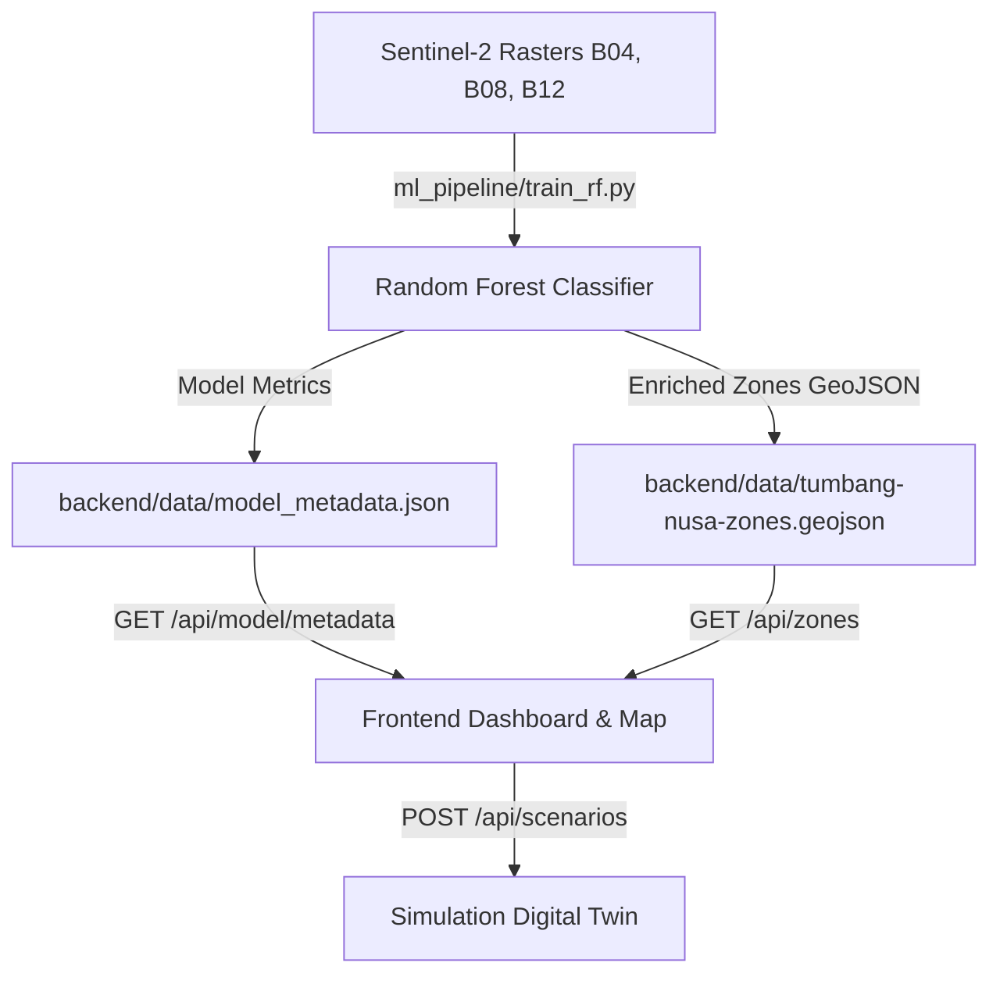

# Reforest AI - Intelligent Peatland & Burn Severity Restoration Platform

Reforest AI adalah platform terintegrasi yang menggabungkan **Machine Learning Pipeline (Satelit Sentinel-2)**, **Backend Rust (Axum)**, dan **Frontend Modern (React + Vite + Leaflet + Tailwind CSS)** untuk pemantauan lahan gambut, klasifikasi tingkat keparahan kebakaran hutan (burn severity), rekomendasi restorasi, dan simulasi *Digital Twin*.

---

## 🏗️ Arsitektur & Alur Data



1. **`ml_pipeline`**: Memproses citra satelit multispectral Sentinel-2 (pra & pasca kebakaran), menghitung indeks vegetasi/kebakaran (dNBR, NDVI, NBR), melatih model Random Forest, dan mengekspor metrik model serta GeoJSON zona teranotasi ke `backend/data/`.
2. **`backend`**: Dibangun dengan **Rust (Axum)** untuk performa tinggi, keamanan memori, dan keandalan REST API. Memuat data dari `ml_pipeline` dan menyediakannya melalui endpoint `/api/*`.
3. **`frontend`**: Aplikasi web interaktif berbasis **React, Vite, Tailwind CSS, Leaflet, dan Recharts** yang menyajikan peta geospasial interaktif, analisis keparahan, rekomendasi restorasi, dan skenario *Digital Twin*.

---

## 🚀 Cara Menjalankan

### 1. Machine Learning Pipeline (`ml_pipeline`)
```bash
cd ml_pipeline
pip install -r requirements.txt

# Opsional: Buat raster sampel dummy untuk pengujian
python generate_sample_rasters.py --output-dir data

# Jalankan training model dan ekspor data ke backend
python train_rf.py --pre-dir data/pre --post-dir data/post
```

### 2. Backend Rust (`backend`)
```bash
cd backend
cargo test   # Menjalankan unit test & integration test API
cargo run    # Menjalankan server backend di http://localhost:8080
```

### 3. Frontend (`frontend`)
```bash
cd frontend
npm install
npm run dev  # Menjalankan development server di http://localhost:5173
```

### 4. Docker Compose (Full Stack)
```bash
docker-compose up --build
```
